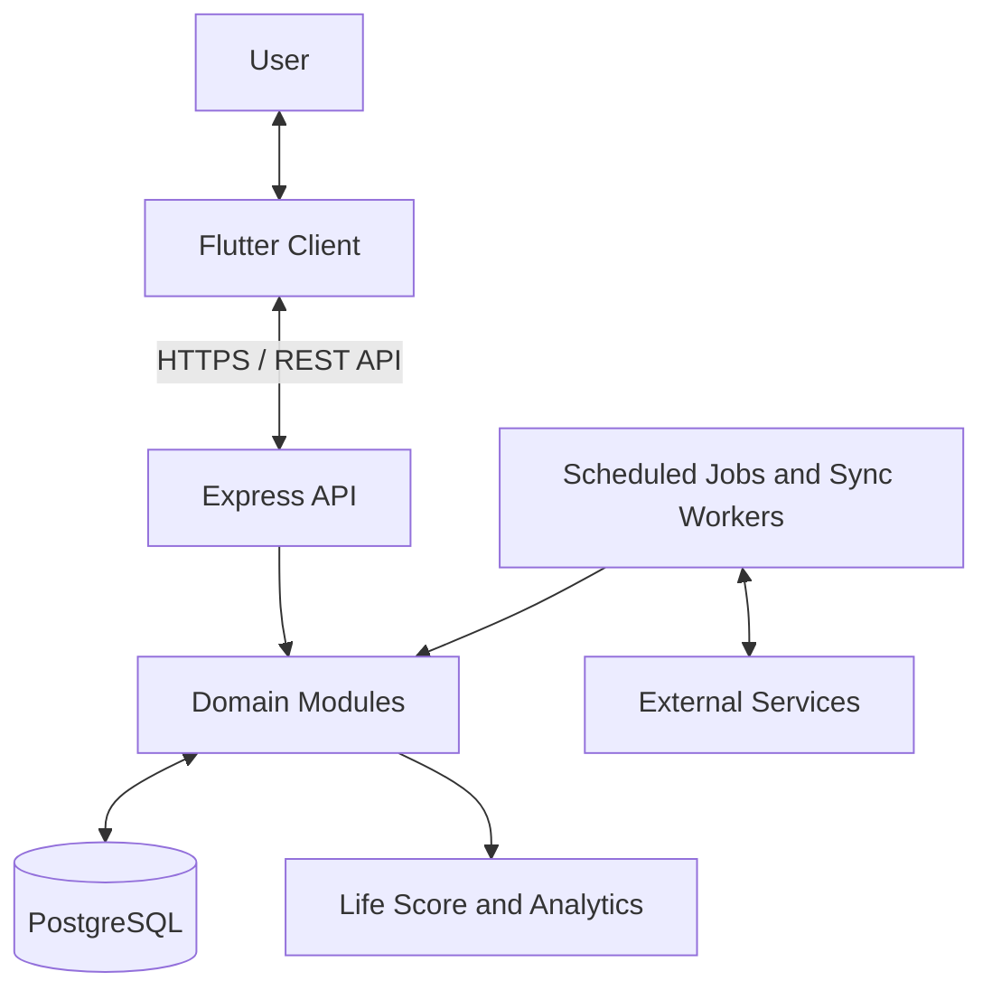

# HabOS — Personal Life Operating System

> **One connected workspace for productivity, learning, software development, fitness, personal finance, and personal growth.**

HabOS is a cross-platform personal management application designed to bring everyday life-tracking tools into one connected system. Its goal is to reduce app switching and help users understand how activities across different areas contribute to their overall progress.

## Table of Contents

- [Overview](#overview)
- [Problem](#problem)
- [Objectives](#objectives)
- [Key Features](#key-features)
- [Architecture](#architecture)
- [Technology Stack](#technology-stack)
- [Repository Structure](#repository-structure)
- [Getting Started](#getting-started)
- [Database Commands](#database-commands)
- [Security](#security)
- [Documentation](#documentation)
- [Team](#team)

## Overview

Many people use separate applications to manage tasks, habits, study sessions, coding progress, workouts, finances, and notes. Because these tools are disconnected, progress in one area often does not appear in a broader view of daily activity.

HabOS is designed to connect these areas through shared data and a **Life Score** ranging from **0 to 100**. For example, completing a task can update related project progress, while logged study or fitness activity can contribute to relevant progress summaries.

## Problem

HabOS addresses five common challenges:

- **App fragmentation:** Managing daily life across many separate applications.
- **Disconnected information:** Progress in one area is not reflected in others.
- **Limited holistic feedback:** It can be difficult to understand consistency across life domains.
- **Manual updates:** The same activity may need to be recorded in multiple places.
- **Data fragmentation:** Information is spread across different services and storage systems.

## Objectives

- Bring personal productivity and tracking tools into one application.
- Provide a configurable, weighted Life Score and progress summaries.
- Use Flutter Clean Architecture to organize the client code.
- Build a modular REST API using Express, TypeScript, Prisma, and PostgreSQL.
- Protect accounts and user data with authentication, validation, and access controls.
- Support scheduled jobs and external integrations where configured.

## Key Features

### Productivity and Time Management

- Task creation, priorities, due dates, and completion tracking.
- Calendar and time-blocked scheduling.
- Habit tracking, streaks, and activity history.
- Focus sessions and Pomodoro-style timers.

### Software Development and Learning

- Project, feature, backlog, and bug tracking.
- Coding activity and repository progress through GitHub integration.
- LeetCode progress synchronization where configured.
- Technology learning roadmaps and resource tracking.

### Academic Management

- Course and semester organization.
- Assignment and examination deadlines.
- Study-session tracking.
- Grade and academic progress calculations.

### Fitness and Personal Finance

- Workout sessions, exercises, sets, repetitions, and training weights.
- Body measurements and personal-record tracking.
- Income and expense records.
- Monthly budgets, threshold alerts, and savings summaries.

### Knowledge and Analytics

- Notes, Markdown content, code snippets, and learning records.
- Goals, milestones, and progress summaries.
- Cross-domain activity analytics.
- AI-assisted summaries and suggestions where configured.

### Life Score

- A composite score on a 0–100 scale.
- Domain-level progress and configurable weights.
- A consolidated view of activity and consistency.

> **Note:** The README describes the project's intended capabilities and architecture. Individual features and integrations may depend on their current implementation and configuration.

## Architecture

HabOS follows a client-server architecture with a Flutter client and a modular Express backend.



### Client: Flutter Clean Architecture

The client separates business rules, data access, and presentation:

- **Presentation:** Screens, widgets, and Riverpod state management.
- **Domain:** Entities, repository contracts, and use cases.
- **Data:** Data models, remote/local data sources, and repository implementations.
- **Core and app:** Networking, shared errors, theme, routing, and application setup.

### Server: Modular Monolith

Backend functionality is grouped into domain modules. A typical module contains:

- `*.routes.ts` — API routes and middleware.
- `*.controller.ts` — HTTP request and response handling.
- `*.service.ts` — Business logic and data operations.
- `*.validation.ts` — Request validation schemas.

This structure keeps related functionality together while allowing modules to share the same application and database infrastructure.

## Technology Stack

| Area | Technologies |
|---|---|
| Mobile and cross-platform client | Flutter, Dart |
| State management | Riverpod |
| Navigation | GoRouter |
| HTTP client | Dio |
| Secure client storage | Flutter Secure Storage |
| Backend runtime | Node.js |
| Backend language | TypeScript |
| API framework | Express.js |
| ORM | Prisma |
| Database | PostgreSQL |
| Request validation | Joi |
| Authentication and password hashing | JWT, bcryptjs |
| Security middleware | Helmet, express-rate-limit |
| Logging | Winston, Morgan |
| Development runner | tsx |
| Containers | Docker, Docker Compose |

## Repository Structure

```text
Hab_os/
├── README.md
├── docker-compose.yml
├── docs/
│   ├── API_VERSIONING.md
│   ├── architecture.md
│   ├── usecases.md
│   └── database/
│       └── schema_reference.md
├── client/
│   ├── pubspec.yaml
│   ├── assets/
│   ├── lib/
│   │   ├── app/
│   │   ├── core/
│   │   ├── domain/
│   │   ├── data/
│   │   ├── presentation/
│   │   └── main.dart
│   └── test/
└── server/
    ├── package.json
    ├── Dockerfile
    ├── .env.example
    ├── prisma/
    │   ├── schema.prisma
    │   └── seed.ts
    ├── scripts/
    ├── tests/
    └── src/
        ├── app.ts
        ├── server.ts
        ├── config/
        ├── middleware/
        └── modules/
```

## Getting Started

### Prerequisites

Install the following tools:

- Node.js 20.x or newer
- npm 10.x or newer
- Flutter SDK 3.19.x or newer
- Docker and Docker Compose, if using the containerized database
- Git

Check your installations:

```bash
node --version
npm --version
flutter --version
docker compose version
```

### 1. Clone the Repository

```bash
git clone https://github.com/boldhab/Hab_os.git
cd Hab_os
```

### 2. Configure and Start the Backend

Navigate to the server directory and install the dependencies:

```bash
cd server
npm install
cp .env.example .env
```

Edit `server/.env` and set the required environment variables, including the database connection and authentication secrets.

**Important:** Do not commit your `.env` file or real secrets to GitHub.

From the project root, start PostgreSQL if you are using Docker Compose:

```bash
cd ..
docker compose up postgres -d
```

Return to the server directory and prepare the database:

```bash
cd server
npm run prisma:generate
npm run prisma:migrate
npm run prisma:seed
```

Start the development server:

```bash
npm run dev
```

The configured API is expected to run at:

- API: `http://localhost:5000`
- Health check: `http://localhost:5000/health`

The health-check URL is available only if the endpoint is implemented and enabled.

### 3. Start the Flutter Client

Open a second terminal from the project root:

```bash
cd client
flutter pub get
flutter doctor
flutter run
```

Connect an Android emulator or a supported physical device before running the app. Follow any setup instructions reported by `flutter doctor`.

## Database Commands

Run these commands from the `server/` directory.

| Command | Purpose |
|---|---|
| `npm run prisma:generate` | Generate the Prisma client. |
| `npm run prisma:migrate` | Create or apply development database migrations according to the project script. |
| `npm run prisma:push` | Synchronize the Prisma schema directly for appropriate prototyping workflows. |
| `npm run prisma:seed` | Insert the project's initial seed data. |

Use migrations for normal development workflows. Use schema push only when appropriate for your local prototyping workflow.

## Security

The project documents the following security measures:

- **Token-based authentication:** Access and refresh token handling.
- **Password hashing:** Passwords are hashed rather than stored as plain text.
- **Request validation:** Joi schemas validate incoming data.
- **HTTP security headers:** Helmet provides security-related response headers.
- **Rate limiting:** Limits repeated requests to sensitive endpoints.
- **User data isolation:** Protected operations should be scoped to the authenticated user.
- **Secure client storage:** Flutter Secure Storage is used for sensitive client-side values.
- **Parameterized database access:** Prisma helps avoid unsafe raw SQL construction when used correctly.

Security depends on correct configuration and implementation. Review the server environment, authorization checks, token lifecycle, and deployment settings before deploying to production.

## Documentation

Additional project documentation is available in the `docs/` directory:

- [`docs/architecture.md`](docs/architecture.md) — System architecture and design.
- [`docs/API_VERSIONING.md`](docs/API_VERSIONING.md) — API versioning approach.
- [`docs/usecases.md`](docs/usecases.md) — Use-case specifications.
- [`docs/database/schema_reference.md`](docs/database/schema_reference.md) — Database schema reference.

## Team

| Contributor | Identification | Main Responsibility |
|---|---|---|
| **Habtamu Befekadu** | `CTC-894-26` | System architecture, Flutter client, database design, and core productivity and life-management modules. |
| **Petros Geto** | `CTC-2934-26` | Authentication, authorization, security middleware, and security verification. |

## Contributing

When contributing:

1. Keep changes focused on a specific feature or fix.
2. Follow the existing client and server architecture.
3. Validate incoming API data and enforce user-level access control.
4. Run relevant tests and analysis before opening a pull request.
5. Update documentation when behavior, setup, or API contracts change.
6. Never commit credentials, tokens, or local environment files.

---

<p align="center">
  <strong>HabOS</strong><br>
  <em>Take control of your personal operating system.</em>
</p>
